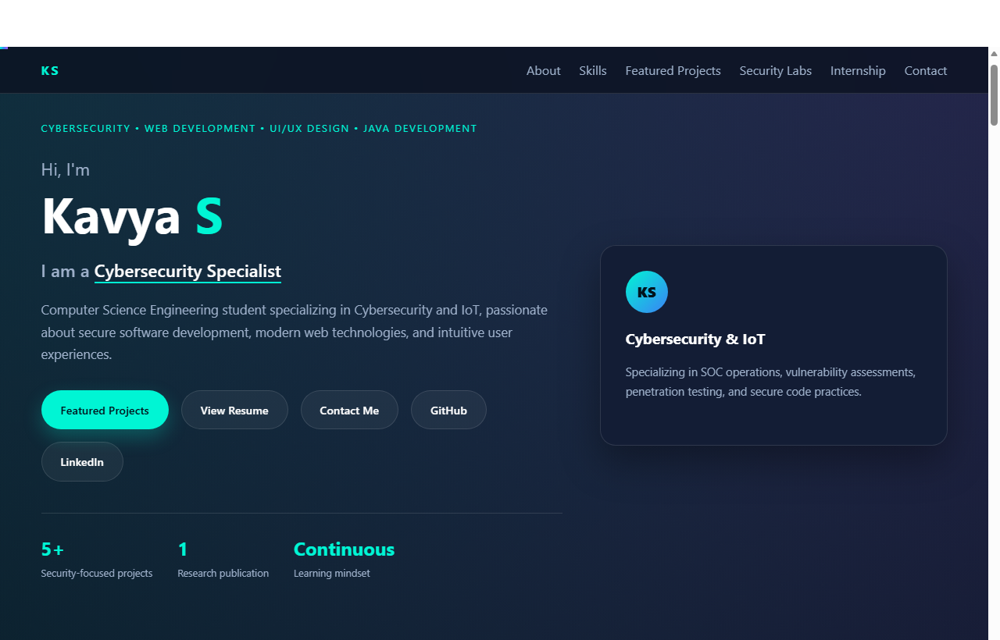
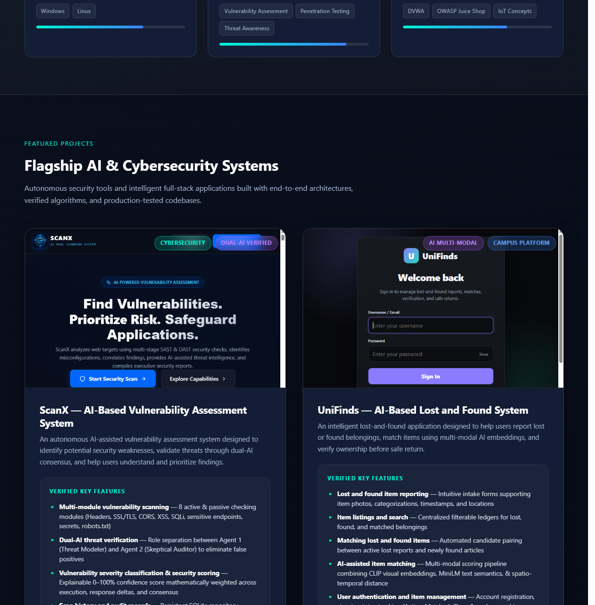
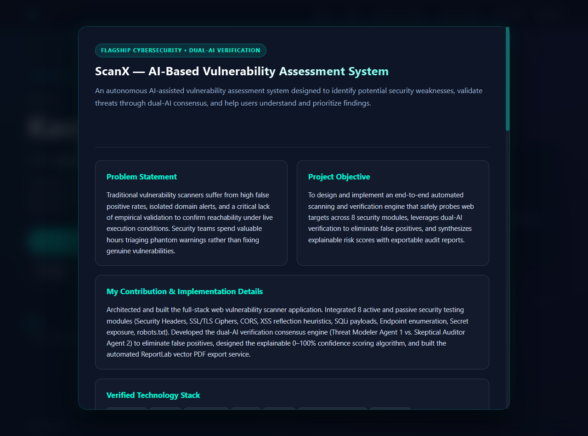
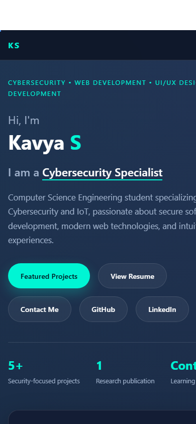
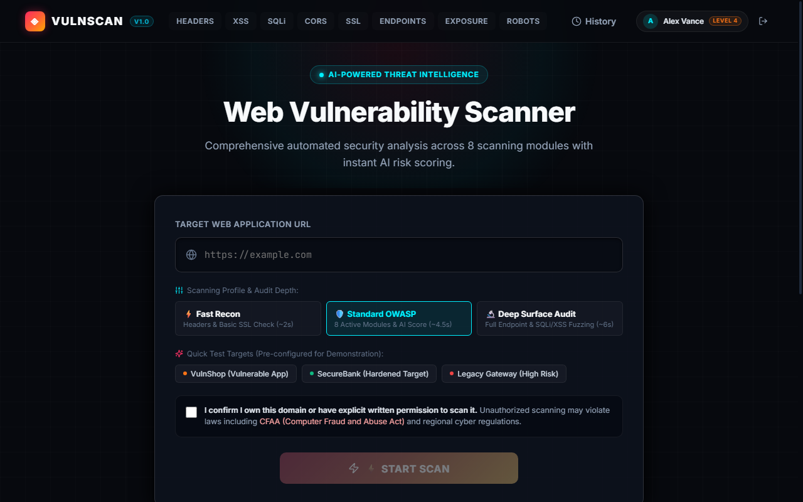
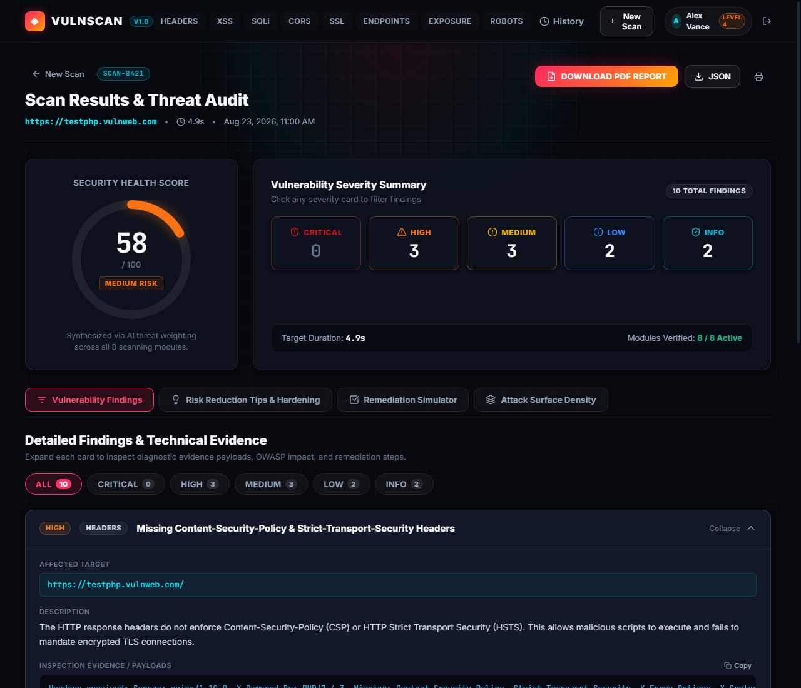
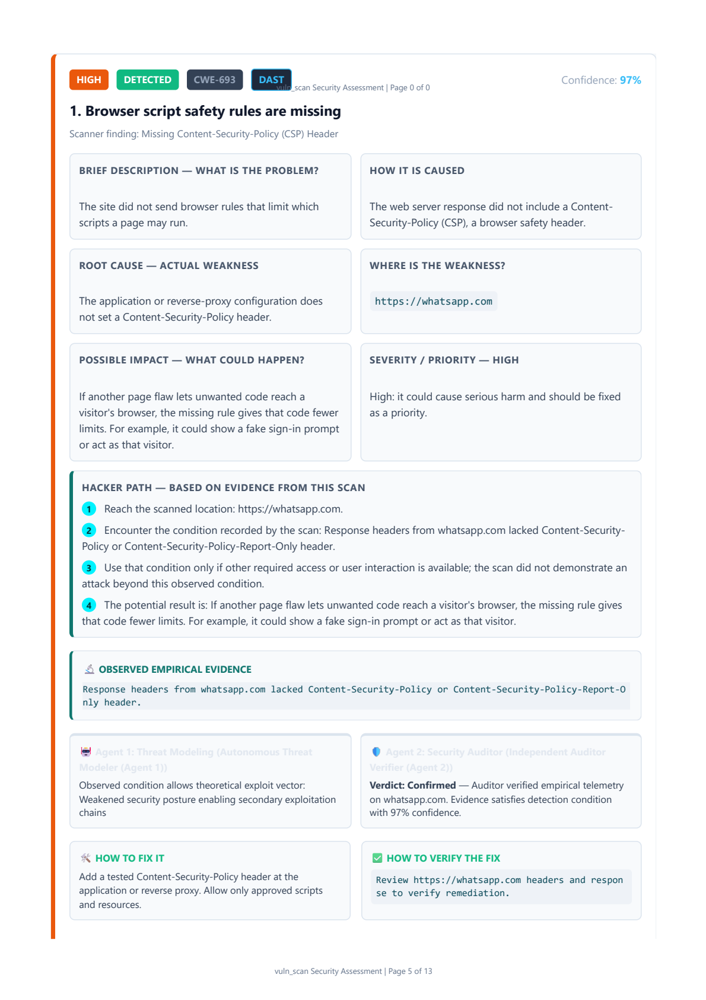
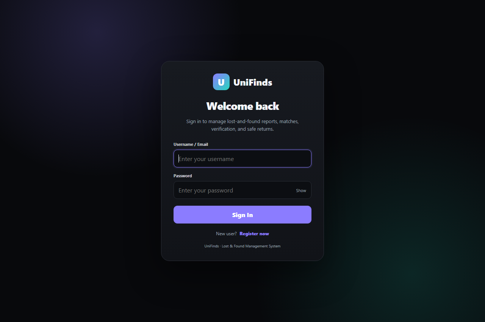
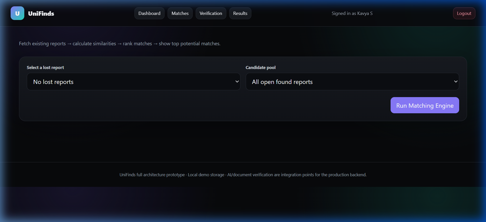
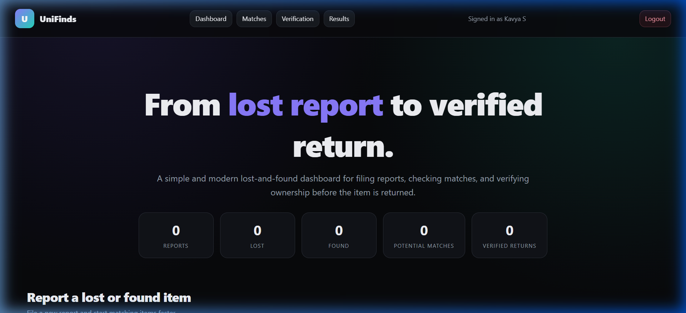

# Personal Engineering & Cybersecurity Portfolio — Kavya S

[](https://vitejs.dev/)
[](https://en.wikipedia.org/wiki/HTML5)
[](https://en.wikipedia.org/wiki/CSS)
[](https://developer.mozilla.org/en-US/docs/Web/JavaScript)
[](https://www.python.org/)
[](https://github.com/kavyasrinivas29)

A personal portfolio showcasing engineering, web development, and cybersecurity projects. Built with vanilla web technologies and styled with a dark navy glassmorphic design, neon cyan accents, dynamic role animations, interactive project filtering, and deep-dive technical showcase modals.

---

## 👤 About Me

I am a **Computer Science Engineering student** specializing in **Cybersecurity and IoT** at **T John Institute of Technology** (expected graduation 2027). My focus spans offensive and defensive security operations, vulnerability assessment and penetration testing (VAPT), network traffic analysis, secure full-stack software development, and intelligent multi-modal systems.

- **Primary Interests**: Security Operations (SOC), Vulnerability Assessment, Web & Network Penetration Testing, Secure Software Engineering, and IoT Access Control.
- **Academic Foundation**: Bachelor of Engineering in Computer Science Engineering (IoT & Cyber Security with Blockchain).
- **Practical Experience**: Network Engineer Intern gaining hands-on exposure to IP configuration, traffic troubleshooting, and operational infrastructure reliability.

---

## 🛠️ Technical Skills

| Domain | Verified Skills & Technologies |
| :--- | :--- |
| **Programming Languages** | Python, Java, SQL, JavaScript (ES6+), HTML5, CSS3, Embedded C++ |
| **Cybersecurity Tools** | OpenVAS, Nmap, Wireshark, Burp Suite, ReportLab (PDF Engine) |
| **Security Labs & Environments** | OWASP Juice Shop, DVWA (Damn Vulnerable Web App), WebGoat |
| **AI & Machine Learning** | PyTorch, OpenAI CLIP (`clip-vit-base-patch32`), Sentence-Transformers (`all-MiniLM-L6-v2`), Scikit-learn |
| **Web & Frameworks** | React 18, Vite 5/6, REST APIs, SQLite3, Responsive UI/UX Design |
| **Networking & Systems** | TCP/IP Protocol Suite, Traffic Analysis, IP Configuration, Linux, Windows |

---

## 🖥️ Portfolio Interface Previews

| Hero & Overview | Featured Flagship Projects |
| :---: | :---: |
|  |  |
| *Hero section with role typing animation and key links* | *Flagship AI & cybersecurity project showcase grid* |

| Detailed Project Showcase Modal | Mobile Responsive Layout |
| :---: | :---: |
|  |  |
| *In-depth modal with problem statement, workflow & gallery* | *Fully responsive layout tailored for mobile displays* |

---

## 🌟 Featured Flagship Projects

### 1. ScanX — AI-Based Vulnerability Assessment System
- **Repository**: [https://github.com/kavyasrinivas29/ScanX-AI-Vulnerability-Assessment](https://github.com/kavyasrinivas29/ScanX-AI-Vulnerability-Assessment)
- **Domain**: Automated Web Application Security & Dual-AI Threat Verification
- **Verified Tech Stack**: Python 3.8+, React 18, Vite 5/6, SQLite3, REST API, ReportLab, Lucide React

#### Problem Statement & Overview
Traditional vulnerability scanners suffer from high false-positive rates and isolated metric alerts without reachability validation. Security teams spend valuable hours triaging phantom warnings. **ScanX** is an autonomous AI-assisted vulnerability assessment system designed to safely identify security weaknesses, validate threats through dual-AI consensus, and help engineers prioritize actionable fixes.

#### Verified Key Capabilities:
- **8-Module Security Scanner**: Actively and passively probes HTTP Security Headers, SSL/TLS Ciphers, CORS misconfigurations, Canary XSS reflections, SQLi error heuristics, hidden REST routes, client-side secret leaks, and robots.txt paths.
- **Dual-AI Verification Consensus**: Implements role separation between **Agent 1 (Autonomous Threat Modeler)** and **Agent 2 (Independent Skeptical Auditor)** to confirm empirical evidence and eliminate false positives.
- **Explainable Health & Confidence Scoring**: Calculates a transparent 0–100% confidence score mathematically weighted across execution integrity, response deltas, and multi-agent consensus.
- **Persistent Scan History & Evidence Repository**: SQLite database storing full scan timelines, target telemetry, and diagnostic logs.
- **Executive Vector PDF Report Generation**: Automated export of 13-page vector security reports containing hacker attack paths, CWE mappings, and verified remediation guidance.

#### Genuine Application Screenshots:
| Interactive Scanning Dashboard | Live Threat Audit & Findings | Dual-AI Verification PDF Report |
| :---: | :---: | :---: |
|  |  |  |
| *Scanning profile selector & CFAA compliance* | *Security health ring (58/100) & severity summary* | *Auditor verdict, hacker paths & CWE-693* |

> 📄 **Sample Vulnerability Report**: A genuine, sanitized 13-page executive security audit report is available for inspection: [`docs/scanx-security-report-sample.pdf`](docs/scanx-security-report-sample.pdf).

---

### 2. UniFinds — AI-Based Lost and Found System
- **Repository**: [https://github.com/kavyasrinivas29/unifinds](https://github.com/kavyasrinivas29/unifinds)
- **Domain**: Multi-Modal Artificial Intelligence & Campus Community Systems
- **Verified Tech Stack**: Python 3.8+, PyTorch, OpenAI CLIP (`clip-vit-base-patch32`), Sentence-Transformers (`all-MiniLM-L6-v2`), SQLite3, HTML5, CSS3, Vanilla JavaScript ES6+

#### Problem Statement & Overview
Campus lost-and-found management is historically fragmented across manual bulletin boards and student messaging channels. Unstructured descriptions make matching lost belongings with found items unreliable. **UniFinds** connects lost and found reports using computer vision and natural language processing while protecting student privacy and preventing fraudulent claims.

#### Verified Key Capabilities:
- **Structured Intake Reporting**: Form flows capturing high-resolution photos, item classifications, date/time timestamps, and campus location tracking.
- **Centralized Item Ledgers & Search**: Organized status tracking (Active, Matched, Closed) across campus reports.
- **Automated Candidate Pairing**: Cross-comparison engine matching active lost tickets against newly submitted found articles.
- **Multi-Modal AI Matching Pipeline**: Weighted similarity fusion combining OpenAI CLIP image embeddings (40%), MiniLM semantic text embeddings (25%), structured attributes (15%), Haversine spatio-temporal distance (15%), and temporal decay (5%).
- **Privacy-First Ownership Verification**: Two-way security verification questionnaires ensuring that rightful owners confirm unique item identifiers before physical return.

#### Genuine Application Screenshots:
| Secure Portal & Authentication | Matching Engine & Candidate Pool | Central Dashboard & Intake |
| :---: | :---: | :---: |
|  |  |  |
| *Access portal for campus members* | *Automated candidate pairing & similarity scoring* | *Intake statistics & item report tracking* |

---

## 🔬 Practical Security Labs & Assessments

In addition to the flagship systems, the portfolio documents practical hands-on security labs demonstrating offensive and defensive capabilities:

1. **OWASP Juice Shop Penetration Testing**
   - *Domain*: Web Penetration Testing • OWASP Top 10
   - *Tools*: OWASP Juice Shop, Burp Suite, Browser DevTools
   - *Focus*: Session validation, broken access control (BOLA), injection verification, client-side data leaks, and defensive remediation reports.

2. **SQL Injection Analysis using DVWA**
   - *Domain*: Application Security • Database Defense
   - *Tools*: DVWA (Damn Vulnerable Web App), MySQL, PHP
   - *Focus*: Systematic analysis of Error-based, Union-based, and Blind SQL injection across progressive difficulty tiers; contrast vulnerable queries with PDO prepared statements.

3. **Network Vulnerability Assessment using OpenVAS**
   - *Domain*: Network Security • Vulnerability Management
   - *Tools*: OpenVAS / Greenbone Vulnerability Management, CVSS v3, CVE Database
   - *Focus*: Network service enumeration, unpatched daemon discovery, CVSS risk prioritization, and remediation roadmap authoring.

4. **Network Scanning & Traffic Analysis using Nmap and Wireshark**
   - *Domain*: Network Reconnaissance • Packet Inspection
   - *Tools*: Nmap, Wireshark, TCP/IP Protocol Suite
   - *Focus*: Active port enumeration, OS/service fingerprinting, TCP three-way handshake inspection, and detection of unencrypted cleartext protocols (HTTP/FTP).

5. **Smart Door Access System**
   - *Domain*: IoT Security • Embedded Access Control
   - *Tools*: Microcontrollers (ESP32), RFID Sensors, Embedded C++, Fail-Secure Hardware
   - *Focus*: Physical access management, credential validation logic, tamper protection, and research publication on security-conscious IoT architectures.

---

## 📂 Project Folder Structure

```text
portfolio/
├── assets/                                 # Website icons, preview images, and documents
│   ├── scanx-dashboard.png                 # ScanX dashboard preview
│   ├── scanx-results.png                   # ScanX scan results preview
│   ├── scanx-report.png                    # ScanX PDF report preview
│   ├── unifinds-home.png                   # UniFinds portal preview
│   ├── unifinds-listings.png               # UniFinds listings preview
│   ├── unifinds-details.png                # UniFinds dashboard preview
│   └── scanx-security-report-sample.pdf    # Downloadable sanitized PDF report
├── docs/
│   ├── scanx-security-report-sample.pdf    # Sanitized 13-page vector report
│   └── screenshots/                        # High-resolution screenshots for GitHub
│       ├── portfolio-home.png              # Portfolio hero section
│       ├── portfolio-projects.png          # Featured projects section
│       ├── portfolio-project-details.png   # Project showcase modal
│       ├── portfolio-mobile.png            # Mobile viewport preview
│       ├── scanx-dashboard.png             # ScanX dashboard screenshot
│       ├── scanx-results.png               # ScanX threat audit screenshot
│       ├── scanx-report.png                # ScanX PDF preview screenshot
│       ├── unifinds-home.png               # UniFinds portal screenshot
│       ├── unifinds-listings.png           # UniFinds matching engine screenshot
│       └── unifinds-details.png            # UniFinds dashboard screenshot
├── favicon.svg                             # Minimalist branded favicon
├── index.html                              # Semantic HTML5 single-page application
├── package.json                            # Vite build script configuration
├── README.md                               # Project documentation & showcases
├── resume.txt                              # Summary resume reference
├── script.js                               # Modal logic, project data, filtering, animations
└── styles.css                              # Cyber dark theme, responsive grid & animations
```

---

## 🚀 Local Installation and Setup

### Prerequisites
- [Node.js](https://nodejs.org/) (v18 or later recommended) or [Python](https://www.python.org/) (v3.8+)
- A modern web browser (Edge, Chrome, Firefox, Safari)

### 1. Clone or Open the Repository
```bash
cd portfolio
```

### 2. Start the Development Server

**Option A — Using Vite (Recommended):**
```bash
# Start development server
npx vite --port 5173

# Or install dependencies and run:
npm run dev
```

**Option B — Using Python Built-in Server:**
```bash
python -m http.server 5173
```

Open your browser and navigate to:
```text
http://localhost:5173
```

### 3. Build for Production
To create an optimized production bundle:
```bash
npx vite build
```
The compiled output will be generated inside the `dist/` directory.

---

## 🌐 Deployment Status
- **Current Status**: Local / In Active Development
- **Deployment Compatibility**: Static-ready for deployment on [GitHub Pages](https://pages.github.com/) or [Vercel](https://vercel.com/).

---

## 🔮 Future Enhancements
- [ ] Add dark/light mode accent toggle with persistent preference
- [ ] Implement automated GitHub Actions workflow for linting and deployment
- [ ] Add interactive live demonstration playground for security concept explanations
- [ ] Expand security lab write-ups with downloadable sanitized terminal capture logs

---

## 📬 Contact & Social Links

- **GitHub**: [github.com/kavyasrinivas29](https://github.com/kavyasrinivas29)
- **Email**: [kavyasrinivas2906@gmail.com](mailto:kavyasrinivas2906@gmail.com)
- **LinkedIn**: [linkedin.com](https://www.linkedin.com/)
